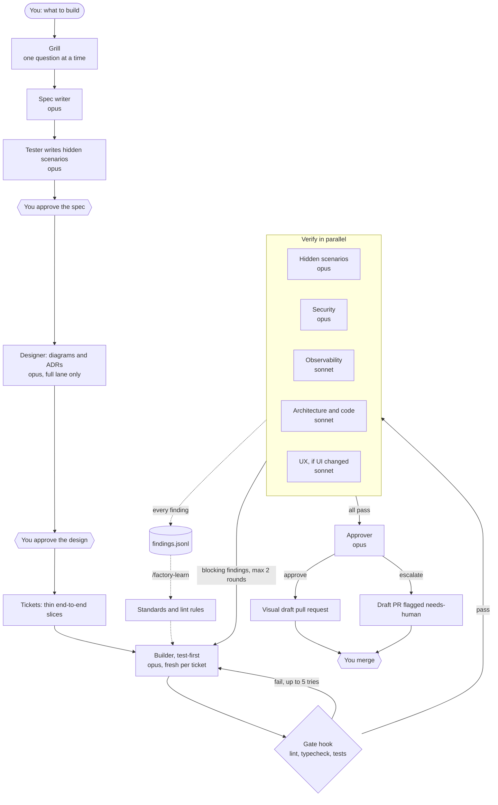

# Software factory for Claude Code

A build line for your own work in Claude Code. You describe what you want. It gets specified, built test-first, linted, tested by an agent the builder cannot see, reviewed by a panel of specialist agents against your standards, and handed to you as a draft pull request with a diagram of the change. You approve the spec and you merge. The factory does the rest.

## Install

```bash
unzip factory-kit.zip
./factory-kit/install.sh /path/to/your/repo
cd /path/to/your/repo && claude
```

Then, inside Claude Code:

```
/factory-setup                 once per repo: finds your lint, typecheck and test commands
/factory add CSV export to the audit log
```

You need `git` and `jq`. `gh` is optional: with it the factory opens the pull request for you.

## Commands

| Command | What it does |
|---|---|
| `/factory <what to build>` | Runs the line. Add `quick`, `standard` or `full` in front to pick a lane. |
| `/factory status` | Lists runs and where each one is. |
| `/factory resume <run-id>` | Picks a run up where it stopped. |
| `/factory-setup` | Detects the stack and fills in `factory/config.json`. |
| `/ingest-standards <file or URL>` | Turns your standards documents into numbered rules. |
| `/factory-learn` | Reads what reviewers keep finding and proposes rules to add, automate or retire. |

## The line



## Lanes

Not every change needs every station.

| Lane | Use for | What runs |
|---|---|---|
| `quick` | A bug fix or small change | Brief, build, gate, security and architecture review, PR |
| `standard` | A normal feature | Everything except the design station |
| `full` | New, risky or cross-cutting work | Everything, with diagrams and ADRs before the build |

## What is enforced and what is judgement

This is the main thing to understand about the factory.

**Enforced by hooks.** These are scripts, so they run every time whatever the model decides:

- **The gate** (`.claude/hooks/gate.sh`). The builder cannot finish while lint, typecheck or tests fail. It gets the output and tries again, up to 5 times, then stops for you. The same gate runs on your ordinary Claude Code sessions in this repo whenever there are uncommitted changes. Turn that off with `gate.enforceOnMainSession: false`.
- **The guard** (`.claude/hooks/guard.sh`). Blocks reading `.env` files and private keys, force-pushes, pushes to the base branch, merging pull requests and `--no-verify`. For the builder it also blocks the hidden scenarios and any edit to the factory's own hooks, config and standards, so the builder cannot loosen its own checks.
- **The formatter** (`.claude/hooks/format.sh`). Formats each file after it is edited.

**Judgement by agents.** These are prompts. They are good, but they are not guarantees:

- The review panel, the tester and the approver. Each runs in its own context and did not write the code, so none of them is marking its own work.
- The orchestrator following the stations in order and stopping at your checkpoints.

The design puts cheap, certain checks first and judgement second, and leaves the merge with you.

## Hidden scenarios

Before the build, the tester writes acceptance scenarios from the spec into `factory/runs/<run>/holdout/`. The builder is blocked from that folder. After the build the tester turns the scenarios into tests and runs them. When one fails, the builder is told which acceptance criterion failed and what the system did, but never sees the test. The code has to meet the spec. It cannot be shaped to pass a test it has read.

## Standards

`factory/standards/` holds six short rulebooks: coding, testing, architecture, security, observability and UX. Each rule has an ID, is marked `[lint]` or `[review]`, and `[blocking]` or `[advisory]`. They are starter rules: edit them freely.

`/ingest-standards docs/engineering-handbook.pdf` reads your own documents, rewrites each requirement as a checkable rule, sorts machine-checkable ones into lint config and the rest onto a reviewer's checklist, and shows you conflicts and anything too vague to enforce before it changes a file.

## Watching the factory

| File | What it holds |
|---|---|
| `factory/findings.jsonl` | Every review finding: rule, severity, reviewer, run, round. Committed. |
| `factory/logs/gate.jsonl` | Every gate run and where it failed. |
| `factory/logs/events.jsonl` | Every station that ran. |
| `factory/runs/<run>/state.json` | Where a run is, and its history. |

`factory/bin/stats.sh` prints the rules broken most often, findings per reviewer and the gate's pass rate. `/factory-learn` reads the same data and proposes up to five changes for you to approve.

## Settings

`factory/config.json`:

| Key | Meaning |
|---|---|
| `commands.*` | Your lint, typecheck, test, format and e2e commands. Empty means skipped. |
| `gate.steps` | Which commands the gate runs, in order. |
| `gate.maxAttempts` | Tries before the gate gives up and calls you. Default 5. |
| `gate.enforceOnMainSession` | Also gate ordinary sessions in this repo. Default true. |
| `loop.maxFixRounds` | Review-and-fix rounds before escalation. Default 2. |
| `reviewers.always`, `reviewers.whenUi` | Which review agents run. Add your own agent here. |
| `tracker` | `local` (tickets as files) or `github` (also creates issues). |
| `baseBranch` | The branch pull requests target. |
| `observability.platform` | Your telemetry platform, so the reviewer judges against its conventions. |

To change which model a station uses, edit `model:` at the top of its file in `.claude/agents/`.

To add a reviewer, copy `review-observability.md`, point it at a new standards file, and add its name to `reviewers.always`.

## Limits to know about

- **Tickets build one at a time**, on one branch. Parallel builders in separate worktrees are faster but bring merge conflicts. That is a later upgrade.
- **Review happens once per feature**, after all tickets are built, not after each ticket. That keeps cost down. Slice large features into several runs.
- **It runs on your machine**, in a Claude Code session. It does not yet run unattended from CI.
- **Cost.** A standard run uses several Opus agents. Use the `quick` lane for small changes.
- **The guard is a seatbelt, not a sandbox.** It blocks the obvious routes to the hidden scenarios and secrets. Claude Code's own permission settings are the proper place for hard limits.
- **Review agents can miss things and can be wrong.** That is why the merge is yours.

## Layout

```
.claude/
  settings.json            hooks: guard, formatter, gate, event log
  agents/                  11 station agents
  skills/                  /factory, /factory-setup, /ingest-standards, /factory-learn
  hooks/                   gate.sh, guard.sh, format.sh, log-event.sh
factory/
  config.json              your commands and limits
  standards/               the rulebooks
  templates/               spec, design, ticket, finding and PR formats
  bin/                     collect-findings.sh, stats.sh
  findings.jsonl           the learning log (created on first run)
  runs/                    one folder per run (git-ignored)
  logs/                    gate and event logs (git-ignored)
```

## Where the ideas come from

| Part | Borrowed from |
|---|---|
| Grill, one question at a time; tracer-bullet tickets; ADR habit | Matt Pocock's skills |
| Spec as the source of truth; standards as a constitution | GitHub Spec Kit |
| Specs written as changes to an existing system | OpenSpec |
| Design station with an architect role | BMAD |
| Test-first builder with a fresh context per ticket; two-pass review | Superpowers |
| Parallel specialist reviewers, capped fix rounds, approver, model tiering | zazencodes' Claude Code software factory |
| Hidden scenarios the builder never sees | StrongDM's software factory |
| Findings feeding back into rules | The harness-engineering idea of fixing the system, not just the code |
