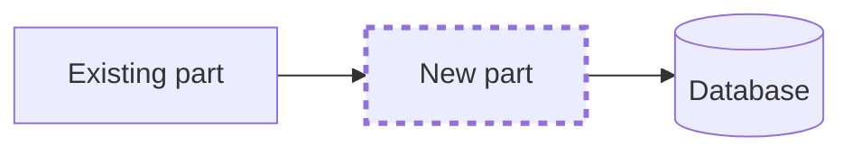
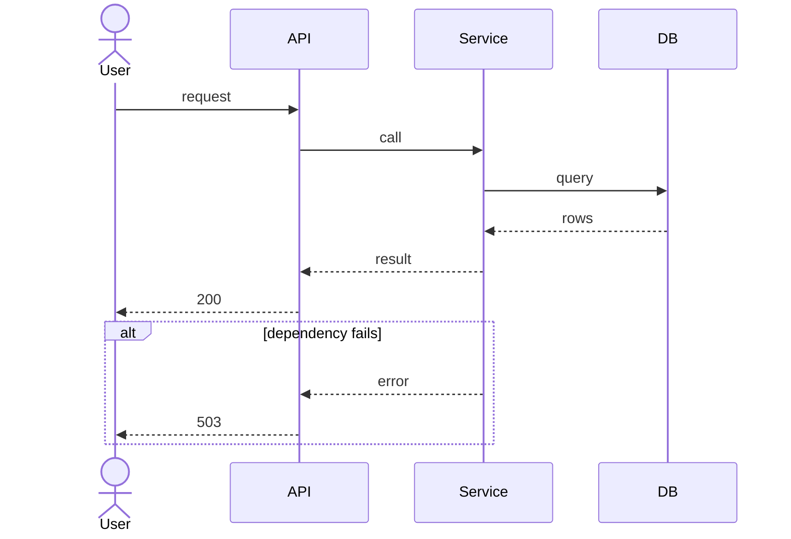

# Design: <title>

Run: `<run-id>` · Spec: `spec.md`

## Components

What this change touches. New parts are marked.

## Main flows

One sequence diagram per main flow, with its main failure path.

## Interface contracts

The builder implements these as written.

- **Functions / classes**: signatures
- **API routes**: method, path, request, responses and error codes
- **Events / messages**: name and shape
- **Data model**: tables, columns, indexes, migrations

## Observability plan

- **Logs**: which events, at which level, with which fields
- **Metrics**: names and labels
- **Traces**: which spans
- **Broken looks like**: the signal a person on call would see

## Risks and rollback

| Risk | Likelihood | What we do about it |
|---|---|---|
| | | |

How this is switched off or reversed:

## Decisions

ADRs written for this change:

- `docs/adr/NNNN-title.md`: one line on what was decided
