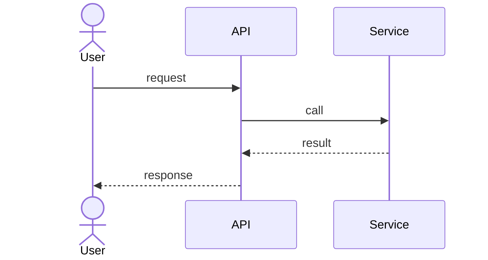

<!-- Only if the approver escalated:
> **Needs a human decision:** <the question, and the approver's recommendation>
-->

**Risk: Low** · one line on why (for example: new code behind an existing interface, no schema or API change)

## What and why

Two or three sentences in plain words. Spec: `docs/specs/<run-id>.md`

## Look here

| File | Lines | What to check |
|---|---|---|
| `src/export/handler.ts` | 20-68 | The permission check before the export starts |
| `src/export/csv.ts` | 1-45 | Escaping of commas and quotes in values |

Safe to skim: tests, config, docs.

## How it works

## Acceptance criteria

| ID | Criterion | Result |
|---|---|---|
| AC-01 | | pass |

## Checks

| Check | Result | Notes |
|---|---|---|
| Gate (lint, typecheck, tests) | pass | |
| Hidden scenarios | 12 of 12 | |
| Security review | PASS | 1 fixed, 0 open |
| Observability review | PASS | 2 fixed, 1 advisory open |
| Architecture review | PASS | |
| UX review | not needed | no UI change |
| Fix rounds | 1 of 2 | |
| Approver | APPROVE | |

## Open advisory findings

- `OBS-016` `src/file.ts:10`: what it is, and why it was left

## Screenshots

| Before | After |
|---|---|
| | |

## How to test it by hand

1. 
2. 
3. 

## Risk and rollback

What could go wrong, and how to switch it off or reverse it.

---
Built by the factory, run `<run-id>`. A human merges.
